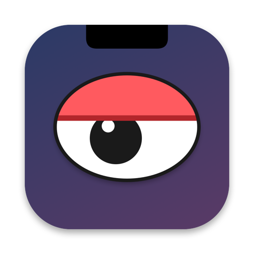
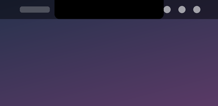
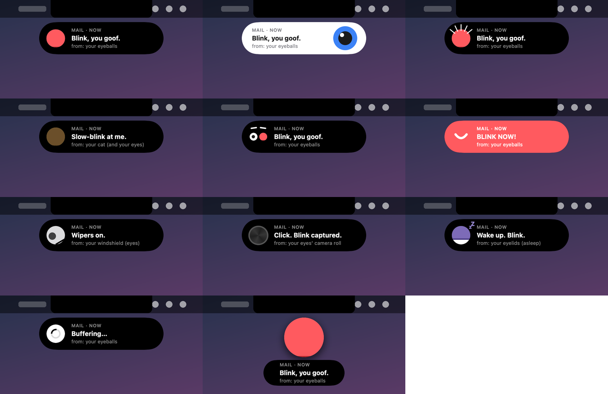

<p align="center">
  
</p>

<h1 align="center">Blink Notch</h1>

<p align="center">
  A tiny Mac menu-bar app that reminds you to blink, with a joke.<br>
  Every so often a circle drops out of your MacBook's notch, turns into a fake "new mail" banner, and a cartoon eye slams its eyelid at you.
</p>

<p align="center">
  
</p>

<p align="center">
  <a href="LICENSE"></a>
  
  
</p>

> The email is fake. Blink Notch never reads your mail, never touches the network, and has no accounts or analytics.

## What it does

- Lives in the menu bar as a small eye icon. No Dock icon, no windows.
- Every 20 minutes (you can pick 10, 20, 30 or 60) it plays a 6.6 second animation:
  a circle drops out from behind the notch, grows into a pill reading **MAIL · NOW / Blink, you goof. / from: your eyeballs**,
  the eye blinks, and the pill shrinks back into a circle and rises away.
- **Eleven different animations**, and it never plays the same one twice in a row (see the gallery below).
- It never takes keyboard focus, clicks pass straight through it, and it shows over full-screen apps, so it
  can't interrupt your typing.
- Nothing fires while the screen is asleep or locked; the countdown restarts when you come back.
- On a screen without a notch (an external monitor) the same animation drops from just below the menu bar.
  It appears on whichever screen your cursor is on.

## Install

You need a Mac running **macOS 14 (Sonoma) or newer**. There is no pre-built download yet, so you build it yourself;
it takes about a minute and only needs Apple's free Command Line Tools (you do **not** need the full Xcode app).

**1. Install the Command Line Tools** (skip if `xcode-select -p` already prints a path):

```bash
xcode-select --install
```

**2. Get the code and build it:**

```bash
git clone https://github.com/lefotugrapher/blink-notch.git
cd blink-notch
scripts/build-app.sh --install
```

This builds `Blink Notch.app` and copies it to `~/Applications`.

**3. Open it.** Launch **Blink Notch** from `~/Applications` (or Spotlight). An eye icon appears in the menu bar.
Choose **Show one now** to see it straight away.

**4. Optional: start it at login.** Click the eye icon and tick **Launch at login**.

Because you build it on your own Mac, macOS treats it as your own software and won't show the "unidentified
developer" warning. If you ever copy the built app to another Mac, right-click it, choose **Open**, and confirm once.

### Uninstall

Quit it from the menu bar, untick **Launch at login** first if you turned it on, then delete `~/Applications/Blink Notch.app`.

## Using it

Click the eye icon in the menu bar:

| Item | What it does |
| --- | --- |
| **Show one now** | Plays a reminder immediately |
| **Pause / Resume** | Stops or restarts the reminders |
| **Every** | Pick 10, 20, 30 or 60 minutes (remembered between launches) |
| **Launch at login** | Starts the app when you log in |
| **Quit** | Quits the app |

## The eleven animations

<table>
<tr>
<td align="center"><br><b>Classic eye</b><br>the original: coral eyelid slams three times</td>
<td align="center"><br><b>The pill is the eye</b><br>a white pill with a giant iris</td>
</tr>
<tr>
<td align="center"><br><b>Fluttering lashes</b><br>lashes flutter on every blink</td>
<td align="center"><br><b>Slow-blinking cat</b><br>two long, lazy blinks</td>
</tr>
<tr>
<td align="center"><br><b>Two little eyes</b><br>blinking one after the other</td>
<td align="center"><br><b>Countdown</b><br>3, 2, 1, then a coral flash</td>
</tr>
<tr>
<td align="center"><br><b>Windshield wiper</b><br>a wiper cleans the eye</td>
<td align="center"><br><b>Camera shutter</b><br>click, click, click</td>
</tr>
<tr>
<td align="center"><br><b>Sleepy eye</b><br>droops with Zs, then snaps awake</td>
<td align="center"><br><b>Buffering eye</b><br>the pupil is a loading spinner</td>
</tr>
<tr>
<td align="center"><br><b>Bouncing eyeball</b><br>no pill at all</td>
<td></td>
</tr>
</table>

Watch them all in one go: [`docs/media/videos/all-styles.mp4`](docs/media/videos/all-styles.mp4) (individual videos are in
[`docs/media/videos`](docs/media/videos), still photos in [`docs/media/stills`](docs/media/stills)).

<p align="center">
  
</p>

All media is rendered by the app itself, so none of it contains anything from a real desktop.

## How it works

- `Sources/BlinkNotchCore`: everything that can be plain logic and is unit tested: the message pool, settings, the
  countdown state machine (pause, sleep, lock), display choice, the pill geometry, and each animation as a pure function
  of time.
- `Sources/BlinkNotch`: the thin Mac layer: a borderless, click-through, never-key panel above the menu bar, the
  SwiftUI drawing, the menu bar item, sleep and lock observers, and launch at login.
- The notch size is read from `NSScreen` at run time, so it adapts to the 14", 16" and Air notches.

Design notes and the mockups the animations came from are in [`docs/superpowers/specs`](docs/superpowers/specs).

## Development

```bash
scripts/test.sh                  # run the test suite (Swift Testing)
scripts/build-app.sh             # build build/Blink Notch.app
scripts/build-app.sh --install   # build and copy to ~/Applications
swift scripts/make-icon.swift    # redraw the app icon
python3 scripts/make-media.py    # regenerate docs/media (needs Pillow and ffmpeg)
```

`scripts/test.sh` exists because XCTest isn't available with only the Command Line Tools. It points the toolchain at the
Swift Testing framework that ships inside them. For the same reason, test files can't `import Foundation`; see
`Tests/BlinkNotchCoreTests/FoundationSupport.swift`.

### Debug switches

Run `build/Blink Notch.app/Contents/MacOS/BlinkNotch` with:

- `--preview`: show one reminder about a second after launch
- `--style <name>`: use only one style: `classic`, `pillEye`, `lashes`, `slowCat`, `twoEyes`, `countdown`, `wiper`, `shutter`, `sleepy`, `buffering`, `bouncingEyeball`
- `--freeze-at <seconds>`: hold one moment of the animation (for screenshots)
- `--message <index>`: use only one message from the pool
- `--render-frames <dir> [--fps n]`: write transparent PNG frames of the animation and exit
- `--dump-menu`: print the menu and exit
- `--login-item-selftest`: register and unregister the login item once, printing the status
- env `BLINKNOTCH_DEBUG_INTERVAL_SECONDS=15`: replace the interval
- env `BLINKNOTCH_DEBUG_NO_NOTCH=1`: pretend there is no notch

## Known gaps

Not tried on real hardware yet (only a MacBook's built-in display was available while building it):

- the external-monitor path (the no-notch layout was checked on the laptop screen with `BLINKNOTCH_DEBUG_NO_NOTCH=1`)
- showing above a full-screen app, and clicking through the pill
- a display being unplugged while a reminder is playing
- live screen sleep and lock (the countdown logic for these is unit tested)
- clicking the menu items (the menu layout is checked with `--dump-menu`; the logic behind each item is unit tested)

If you find a bug, please open an issue.

## Contributing

Issues and pull requests are welcome. Run `scripts/test.sh` before sending a change. New animation ideas are especially welcome:
a style is a case in `BlinkStyle`, a timeline in `PillAnimation`, and a drawing in `EyeAvatarView`.

## License

[MIT](LICENSE) © 2026 Kshitiz Mittal
